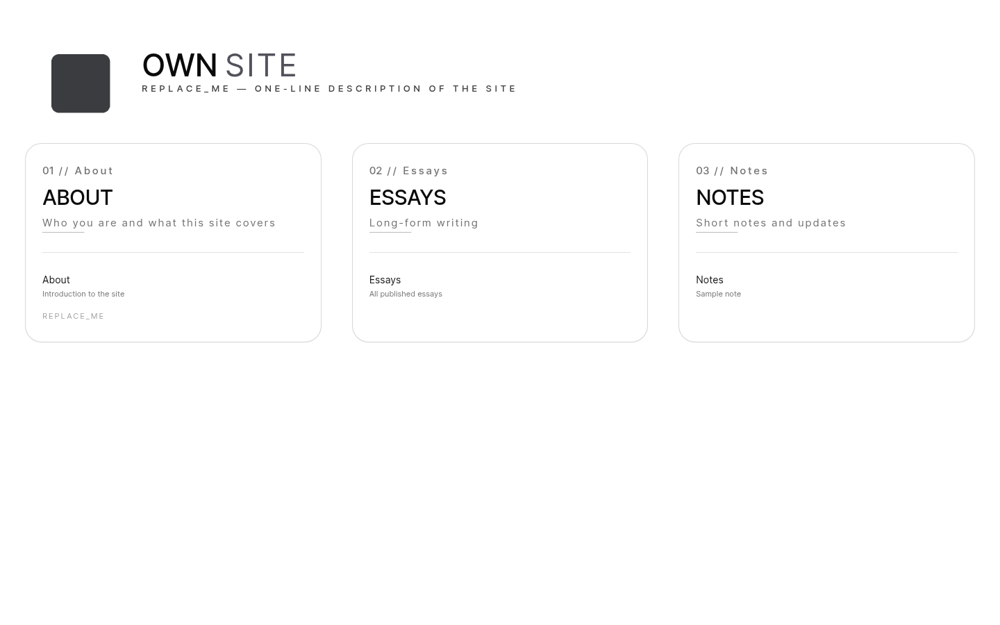
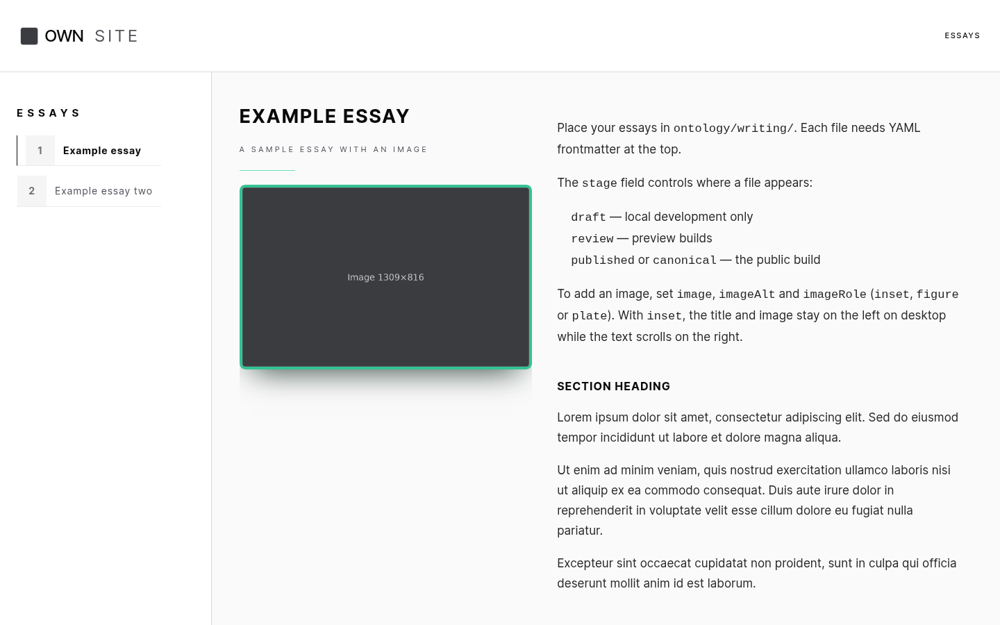

# Own Site

**A free, open-source website template for writers and small businesses who want to own their site.**

Own Site is a static website template built with Next.js. You write in Markdown, run one build command, and host the result anywhere, including free on GitHub Pages or Cloudflare Pages. There is no database, login page or plugin system to maintain. It's MIT-licensed, so you can use it for personal or commercial sites. An AI assistant can set it up for you by following [SETUP.md](SETUP.md).

Built by [Ashit Milne](https://transition-insight.org/) in Toronto. Read more on the [Your Own Site](https://transition-insight.org/chronicle/own-site/) page.

Clone it, open it in an IDE, and drop in your own writing.

Display name: **Own Site**. Repo: `own-site`.

The app shell (layouts, bento home, reading routes, theming, draft→published frontmatter) is inspired by [Transition Insight](https://github.com/transition-insight-labs/transition-insight). This template does not include that project's personal corpus.

## Preview

Home:


Example essay:


Using an AI assistant? Point it at [SETUP.md](SETUP.md) and it will ask you a few questions and set up the site.

## Install and run

```bash
npm install
npm run dev
```

Open [http://localhost:3000](http://localhost:3000).

For an AI-IDE walkthrough, see [How to Build a Web Application Using Own Site and an AI IDE](docs/how-to-build-with-ai-ide.md).

Production static export:

```bash
npm run build
```

That writes `out/` (Next.js `output: "export"`). Preview with any static file server.

Optional content tiers:

```bash
npm run dev:local     # drafts visible
npm run build:preprod # review + published
npm run build:global  # published / canonical only
```

## Where your content goes

Put Markdown (or MDX) under **`ontology/`**. That is the corpus root. There is no `src/content` tree in this scaffold.

```
ontology/
  site/about.md          →  /site/about/
  writing/welcome.md     →  /writing/welcome/  and hub  /writing/essays/
  writing/sample.md      →  /writing/essays/sample/
  notes/sample-note.md        →  /notes/sample-note/
  notes/draft-note.md    →  local only (stage: draft)
```

Each file uses YAML frontmatter. Required-ish fields:

```yaml
---
title: REPLACE_ME
subtitle: REPLACE_ME
slug: my-slug
stage: draft          # draft | review | published | canonical
order: 1
publishedAt: 2026-01-01
tags:
  - REPLACE_ME
series: writing      # section this entry belongs to (matches its folder under ontology/)
showInNav: true
---
```

- **`stage: draft`** — `next dev` only. Production `npm run build` hides it.
- **`stage: review`** — included in `build:preprod`.
- **`stage: published`** or **`canonical`** — public export.

Replace the placeholder posts. Do not leave `REPLACE_ME` in shipped writing.

Home columns and reading-header siblings live in `src/config/site.ts` (`BentoRegistry`). Point `href` at `/topic/slug` routes that match files under `ontology/`.

Hub example: `src/lib/content-routes.ts` maps `/writing/essays` to the `ontology/writing/` folder.

## Site identity

Everything visible about the site is set in `src/config/site.ts`: name, tagline, description, author, the line at the bottom of the first home card (`colophon`), and the home columns. The headers read from it, so you do not need to edit components. A two-word name is shown as a two-tone wordmark (first word, then the rest).

Copy `.env.local.example` to `.env.local` for `NEXT_PUBLIC_SITE_URL` and optional IPFS keys. Never commit `.env.local`.

## Optional ship / IPFS

`npm run ship` builds a global export. Add `--ipfs` only if you have filled `PINATA_JWT` in `.env.local` (see `.env.sovereign.example`, which lists the optional IPFS and Pinata keys; copy the ones you need into `.env.local`). These scripts are examples, not required to use the site.

```bash
npm run ship
npm run ship -- --push -m "Publish first essay."
npm run ship -- --mirror
npm run ship -- --ipfs
```

- `--push` commits and pushes to `main`. Markdown under `ontology/` whose `stage` is not `published` or `canonical` (drafts, reviews, or no stage) is left out of the commit and listed, so unfinished writing stays on your machine.
- `--mirror` copies the built site in `out/` to the `gh-pages` branch of another repo, for example to serve it on GitHub Pages. Set `MIRROR_REPO=REPLACE_ME/REPLACE_ME` (owner/repo) in `.env.local`, and `MIRROR_CNAME=your.domain` if it uses a custom domain. It replaces that branch on every run and never touches `main`.

## Checks

```bash
npm test
npm run lint
npm run build
```

## Licence and disclaimer

Own Site is released under the [MIT License](LICENSE). You are free to use, modify and redistribute it, including for commercial use, as long as the licence notice stays with the code.

- It is provided as is, with no warranty of any kind.
- The author is not liable for any loss, damage, downtime, data loss or security issue arising from its use.
- You are responsible for your own content, hosting, domains, keys and secrets, backups, and for complying with the laws where you publish (for example privacy, copyright and accessibility).
- Third-party services you use with it (GitHub, IPFS and Pinata, hosting providers, AI assistants) have their own terms.
- This is not legal advice.

The licence covers the template code only. Your own writing and images remain yours.
